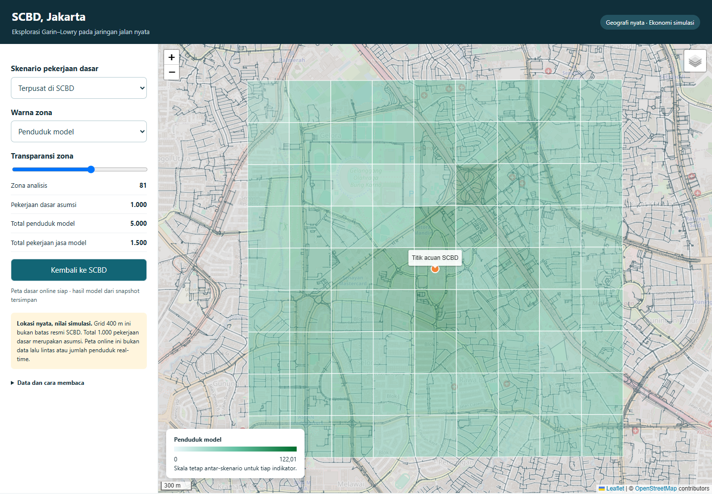

# Studi lokasi nyata: SCBD Jakarta

Kasus baru ini menggunakan koordinat SCBD dan jaringan jalan OpenStreetMap Jakarta. Kasus hipotetis lama dan kedua arsip `.knwf` terverifikasi tetap dipertahankan sebagai baseline. CBD pada baseline lama bukan nama lain untuk SCBD Jakarta.

## Buka peta

Jalankan `Launch_SCBD.ps1` dari folder proyek. Browser membuka:

http://127.0.0.1:8765/SCBD_Jakarta_Live.html

Server hanya mendengarkan di komputer lokal dan hanya menyajikan `outputs/scbd_jakarta`, bukan seluruh repository. Server perlu tetap berjalan; hentikan dengan Ctrl+C. Peta dasar memerlukan internet. GitHub menampilkan sumber HTML; untuk memakai petanya, clone/unduh proyek dan jalankan launcher.

Peta dapat digeser dan diperbesar, menampilkan popup tiap zona, dan mengganti tiga skenario serta indikator warna. Transparansi bisa diubah dan lapisan jalan/zona dapat dimatikan. Skala warna setiap indikator tetap sama antar-skenario.



## Data nyata dan asumsi

| Komponen | Status |
|---|---|
| Posisi SCBD | Titik acuan 106.80966 BT, 6.22651 LS |
| Jalan | Snapshot OpenStreetMap, diambil melalui Overpass; data mentah dan kueri disimpan |
| Proyeksi hitungan | UTM 48S, EPSG:32748, satuan meter |
| Zona | 81 grid analisis 400 × 400 m; jendela 3,6 × 3,6 km |
| Batas zona | Buatan untuk analisis, bukan kelurahan dan bukan batas resmi SCBD |
| Pekerjaan dasar | Asumsi 1.000 pekerjaan; bukan statistik aktual SCBD |
| Penduduk / jasa | Keluaran Garin–Lowry, bukan data sensus |
| Waktu perjalanan | Biaya jaringan dengan kecepatan asumsi; bukan lalu lintas live |

Jaringan memakai komponen terhubung terbesar berdasarkan ID simpul OSM. Tidak ditambahkan jalan penghubung fiktif. Persimpangan ditentukan oleh ID simpul, sehingga persilangan garis pada jalan bertingkat tidak otomatis menjadi simpul. Centroid terhubung ke simpul terdekat dengan biaya akses 5 km/jam; simpul bisa berulang antar-zona. Jaringan disederhanakan dua arah dan tidak memodelkan larangan belok. Kelas jalan menentukan asumsi kecepatan 10–40 km/jam. Biaya internal zona ditambah 0,5 menit agar positif. Model memakai parameter lama h=2 dan e=0,3 dengan eksponen 1.

Tiga skenario: **merata**, **SCBD terpusat** (600 pekerjaan di zona pusat dan 400 di 80 zona lain), serta **tiga pusat** (400 di SCBD, 300 di masing-masing dua zona di barat/timur). Kedua pusat tambahan adalah lokasi kebijakan simulasi, bukan klaim pusat bisnis resmi. Total pekerjaan dasar tetap 1.000, sehingga model menghasilkan total penduduk 5.000 dan pekerjaan jasa 1.500 di semua skenario; perbedaannya adalah sebaran spasial.

## Reproduksi

```powershell
& .\.venv\Scripts\python.exe -m src.scbd_case
& .\.venv\Scripts\python.exe -m pytest tests -q
& .\Launch_SCBD.ps1
```

Penghitungan ulang memakai `data/scbd_jakarta/raw/osm_network.json` yang tersimpan. Tidak diam-diam mengambil versi jaringan berbeda. Waktu snapshot, endpoint, kueri, hash data, jumlah komponen yang dikeluarkan, jarak snap dan residual solver tercatat pada `data/scbd_jakarta/raw/download.json` serta `outputs/scbd_jakarta/provenance.json`. Batas area kueri lebih besar daripada jendela analisis agar rute dapat melewati jalan di luar grid.

Pemeriksaan browser tambahan memakai Playwright (opsional, bukan dependency model): jalankan server, instal `playwright` dan Chromium, kemudian jalankan `python knime/setup/verify_scbd_browser.py`. Bukti ada pada `outputs/scbd_jakarta/browser_validation.json` dan tiga PNG tangkapan layar browser. PNG tersebut bukan tangkapan layar KNIME.

## Tampilkan di KNIME

Peta SCBD sudah diuji sebagai HTML di browser. **Belum ada arsip KNIME SCBD baru yang diekspor dan diuji melalui GUI.** Jangan menyebut `.knwf` hipotetis lama sebagai workflow SCBD.

1. Impor workflow extended yang sudah terverifikasi dan simpan sebagai salinan terpisah.
2. Tambahkan cabang baru **String Configuration → Python View**, melalui port flow variable. Beri nama variabel `scbd_project_root`, nilainya folder repository lokal yang memuat `README.md` dan `src`.
3. Pilih interpreter `.venv/Scripts/python.exe` pada konfigurasi Python View.
4. Salin seluruh kode `knime/scripts/scbd_jakarta_view.py` ke Python View. Adapter membaca hasil SCBD yang sudah dihitung dan menanamkan JS/CSS ke tampilan; tidak mengganti 34 node lama.
5. Execute Python View, lalu Open View. Izinkan akses internet untuk peta dasar. Periksa bahwa SCBD berada di Jakarta, terdapat 81 zona dan tiga skenario, popup bekerja, serta atribusi OpenStreetMap terlihat.
6. Untuk tampilan Geospatial View asli, gunakan **GeoFile Reader** dengan `outputs/scbd_jakarta/scbd_terpusat.gpkg`, layer `zones`, lalu hubungkan ke **Geospatial View**. Pilih `geometry`, warna `population`, **base map = OpenStreetMap**, aktifkan legend dan popup `zone_id`, `population`, `basic_employment`, `service_employment`. Sumber sudah ber-CRS EPSG:32748; jangan assign EPSG:4326 ke koordinat UTM. GeoFile Reader membaca CRS dari GPKG.
7. Setelah eksekusi GUI berhasil, gunakan File → Export KNIME Workflow, kemudian impor ulang, reset dan execute untuk memverifikasi arsip baru. Tahap ini belum diklaim selesai otomatis.

## Sumber

- [Profil resmi SCBD](https://www.scbd.com/menu/page/profile): konteks kawasan bisnis terpadu Jakarta.
- [Titik acuan SCBD, Wikidata Q30590531](https://www.wikidata.org/wiki/Q30590531).
- [OpenStreetMap contributors](https://www.openstreetmap.org/copyright): data jalan berlisensi ODbL 1.0. Atribusi berlaku juga untuk data turunan.
- [Overpass API](https://wiki.openstreetmap.org/wiki/Overpass_API): pengambilan subset data jalan.
- [Leaflet 1.9.4](https://leafletjs.com/reference-1.9.4.html) dan [ketentuan tile OSM](https://operations.osmfoundation.org/policies/tiles/). Library lokal dilengkapi lisensi; tile hanya dimuat sesuai viewport, tanpa bulk download.
