# 1. Pendahuluan

## 1.1 Latar Belakang

Lokasi kegiatan ekonomi memengaruhi pilihan tempat tinggal, sedangkan sebaran penduduk membentuk kebutuhan pelayanan. Analisis SIG dapat membantu memahami hubungan ini dengan menghubungkan atribut ekonomi, zona geografis, dan jaringan transportasi. Model Garin–Lowry menyusun hubungan tersebut sebagai sistem interaksi spasial. Model Lowry diperkenalkan dalam A Model of Metropolis [1], sedangkan formulasi matriks Garin membantu menyatakan alokasi kegiatan secara matematis [2]. Implementasi pada laporan ini mengikuti Case 10 dalam lab manual Liu dan Wang [3].

Kota yang dianalisis bersifat hipotetis. Bentuknya berupa satu zona CBD di pusat serta sembilan cincin luar yang dibagi menjadi 15 sektor. Total zona adalah 1 + 9 × 15 = 136. Bentuk kota memudahkan pengamatan pengaruh lokasi pekerjaan dan biaya perjalanan tanpa menyamakan hasil dengan kondisi kota nyata.

## 1.2 Tujuan dan Pertanyaan Penelitian

- Mereproduksi dan memperbaiki workflow KNIME Case 10 asli, kemudian memvalidasi hasil perhitungannya.
- Menghasilkan matriks OD jaringan serta distribusi penduduk, pekerjaan jasa, dan seluruh pekerjaan.
- Membandingkan perubahan lokasi pekerjaan dasar, friction, dan kecepatan jalan.
- Menambahkan studi mandiri tiga pusat pekerjaan dengan total pekerjaan yang dipertahankan.
- Menyediakan keluaran yang dapat ditelusuri: data, tabel, peta, log, tangkapan layar, dan laporan.

Pertanyaan utamanya adalah bagaimana perubahan pekerjaan dasar dan aksesibilitas mengubah pembagian penduduk serta pekerjaan jasa antarzona. Pertanyaan tambahan menilai apakah pembentukan dua pusat satelit mengurangi konsentrasi terhadap CBD tunggal.

## 1.3 Penjelasan Model dengan Bahasa Sederhana

Bayangkan pekerjaan dasar sebagai kegiatan yang menopang ekonomi kota dari luar sistem model. Pekerjaan tersebut mendukung penduduk. Penduduk membutuhkan toko, jasa, dan layanan lain. Kebutuhan ini menghasilkan pekerjaan jasa. Pekerjaan jasa juga mendukung penduduk tambahan, sehingga terbentuk hubungan umpan balik. Model mencari pembagian antarzona yang konsisten dengan seluruh hubungan itu.

Pekerjaan dasar tidak harus diartikan sebagai semua pekerjaan industri yang benar-benar ditemukan di lapangan. Dalam eksperimen ini, lokasinya ditetapkan sebagai input. Pekerjaan jasa adalah kegiatan pelayanan dalam model, bukan klasifikasi rinci seluruh jenis retail. Hasil penduduk adalah jumlah per zona, bukan kepadatan per km².

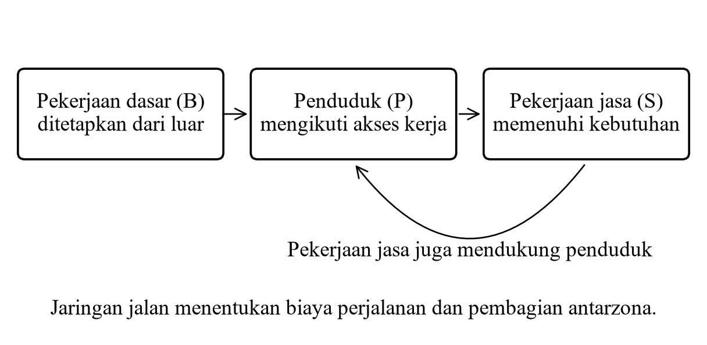

**Analogi total kota.** Jika ada 100 pekerjaan dasar, setiap pekerjaan total mendukung dua penduduk, dan setiap penduduk menghasilkan 0,3 pekerjaan jasa, maka hubungan totalnya adalah P = 2 × (100 + 0,3P). Penyelesaiannya P=500 dan S=150. Pemeriksaan iteratif memberi tahap pertama 200, tambahan umpan balik 120, lalu 72, dan seterusnya. Deret tersebut menuju keseimbangan 500; iterasi bukan tahun dan bukan pertumbuhan demografis yang diobservasi.

## 1.4 Ruang Lingkup dan Asal Studi

Laporan membedakan tiga hal: data geografis asli yang disuplai, tujuh skenario yang sudah dieksekusi pada tahap sebelumnya, dan satu studi mandiri baru. Lab manual memperkenalkan kota monosentris, perubahan pekerjaan menjadi uniform, friction yang lebih tinggi, serta beltway. Implementasi sebelumnya juga memuat friction rendah dan kombinasi kasus CBD. Kebijakan 40%–30%–30% pada laporan ini dirancang sendiri dan tidak diatribusikan sebagai skenario asli buku.

# 2. Metodologi

## 2.1 Alat, Data, dan Audit

| Komponen | Hasil pemeriksaan |
|---|---|
| Perangkat utama | KNIME Analytics Platform 5.12.0; Geospatial Analytics 2.1.0 |
| Komputasi pendukung | Python 3.11.9, NumPy, SciPy, Pandas 2.3.3, GeoPandas, NetworkX |
| Poligon tract.zip | 136 poligon valid; ditemukan pada Data/Lousiana |
| Centroid trtpt.zip | 136 titik valid; ORIG_FID unik 1–136 |
| Jaringan road.zip | 330 garis valid; panjang dihitung dari geometri |
| Sistem koordinat | EPSG:3857, satuan planar meter proyeksi |
| Kunci geografis | zone_id, diturunkan dari ORIG_FID dan kecocokan spasial |
| Data referensi numerik | Tabel OD, penduduk, dan jasa yang tersimpan dalam workflow asli |

Folder data tidak sepenuhnya sesuai nama dalam manual: geografi kota ditemukan pada Data/Lousiana, sedangkan skrip matriks ditemukan pada Data/SimuCity. Tidak ada dataset pengganti yang diunduh. Seluruh geometri asli diperiksa valid dan setiap poligon memiliki tepat satu centroid yang sesuai.

TRACT0_ID tidak digunakan sebagai ID unik. Sebanyak 126 rekornya bernilai nol; nilai 1–10 hanya menandai sepuluh zona transek pada satu arah. ORIG_FID adalah pengenal unik centroid. Kunci zone_id pada poligon diperoleh melalui pencocokan centroid di dalam poligon, bukan dengan menggabungkan TRACT0_ID yang berulang. CBD adalah zona 71.

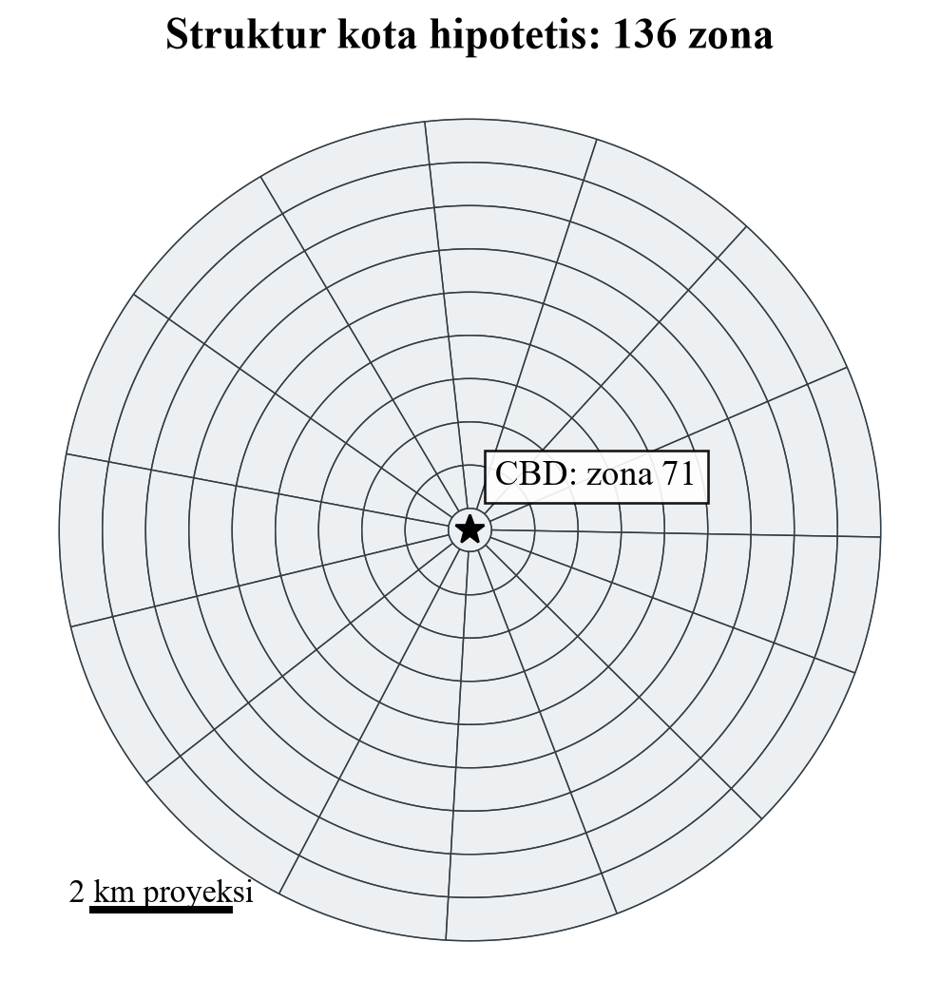

## 2.2 Pelestarian dan Pengembangan Workflow KNIME

Workflow asli memiliki dua bagian besar, yaitu OD Distance dan Garin–Lowry. Sebelum pengembangan, jalur input lama pada drive E: tidak ditemukan, beberapa cache tipe geometri lama tidak kompatibel, dan copy workspace yang rusak kehilangan empat koneksi input Python kedua. Perbaikan dimulai dari arsip asli yang tetap disimpan sebagai backup.

Seluruh 26 node dan 34 koneksi asli dipertahankan. Versi sebelumnya menambahkan enam node menjadi 32 node. Pengembangan laporan ini menggunakan copy terpisah, memperluas keluaran skenario, dan menambahkan Row Filter #33 serta Geospatial View #34. Versi laporan mempunyai **34 node dan delapan skenario**. Arsip final tujuh skenario tidak ditimpa.

| Tahap | Node utama | Keluaran |
|---|---|---|
| Inisialisasi | Python #27 | Path portabel, validasi data, tabel parameter |
| Input geografi | GeoFile Reader #1, #2, #28 | Centroid, jaringan, dan poligon |
| OD jaringan | Road Network Distance Matrix #4 | 18.496 pasangan asal–tujuan |
| Koreksi biaya | Joiner #5–6, Math Formula #7 | netwkTime bernilai positif |
| Matriks alokasi | Math Formula, Pivot, RowID, Transposer #8–17 | Matriks G dan T |
| Solver asli | Python #18, #20–22 | Penduduk P dan pekerjaan jasa S |
| Hasil dasar | Column Appender #24 | 136 baris hasil kota lengkap |
| Profil asli | Row Filter #25, Plotly #26 | Sepuluh zona transek |
| Skenario dan GIS | Python #29, Joiner #30 | 1.088 baris hasil bergeometri |
| Peta baseline | Filter #31, View #32 | 136 poligon baseline uniform |
| Peta studi mandiri | Filter #33, View #34 | 136 poligon kota tiga pusat |

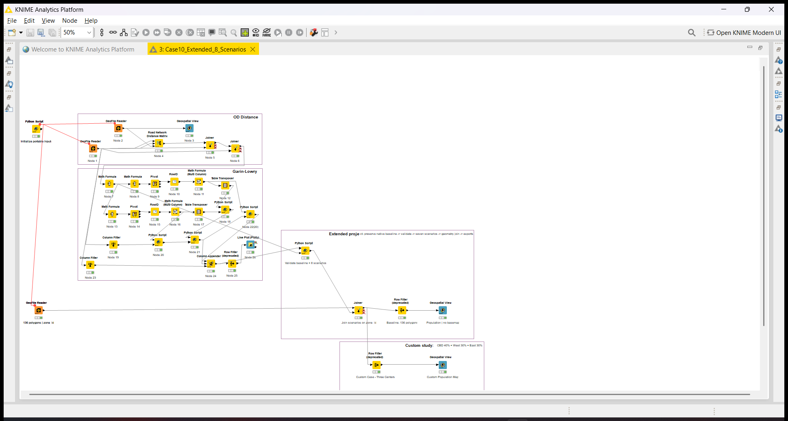

Input workflow menggunakan data area melalui API knime.scripting.io [4]. Environment Python dibuat terisolasi. Perbaikan kompatibilitas node Road Network diterapkan pada salinan lokal ekstensi dengan mekanisme konfigurasi sumber Python yang didokumentasikan KNIME [5]. Instalasi utama dan data asli tetap dipertahankan. Prosedur rinci ada pada docs/KNIME_SETUP.md.

## 2.3 Pembentukan Matriks OD

Jaringan dimodelkan tidak berarah karena tidak tersedia aturan satu arah. Centroid diproyeksikan ke ruas jalan terdekat, dan garis dibagi pada lokasi proyeksi. Graf hasil memiliki 331 simpul dan 466 sisi serta satu komponen terhubung. Jarak dan durasi dihitung dengan Dijkstra memakai bobot masing-masing; jarak lurus tidak menggantikan rute jaringan.

Durasi suatu ruas dihitung sebagai panjang proyeksi dibagi kecepatan. Konversinya adalah 1 mph = 26,8224 meter per menit. Kolom speed dan speed1 yang tidak ada pada SHP dipulihkan dari cache reader workflow asli setelah semua ROAD0_ dan geometri WKB dipastikan identik. Kecepatan baseline 30 mph; speed1 menaikkan 20 fitur bertipe r7 menjadi 75 mph, sesuai manual.

Matriks memuat 136 × 136 = 18.496 pasangan, termasuk diagonal. Diagonal jaringan nol, tetapi model menambahkan biaya lokal sehingga biaya yang dipakai fungsi friction menjadi positif. Rumus asli node #7 dipertahankan:

**c_ij = durasi_jaringan_ij + (PERIMETER_i + PERIMETER_j) × 0,25 × 1.000 / 804,67.**

PERIMETER dideskripsikan dalam manual sebagai kilometer. Ada perbedaan kecil antara skala atribut panjang lama dan panjang geometri proyeksi. Karena tujuan pertama adalah reproduksi, konvensi asli ini dipertahankan secara eksplisit. Snap distance dicatat, tetapi tidak ditambahkan lagi ke rumus agar definisi baseline tidak berubah.

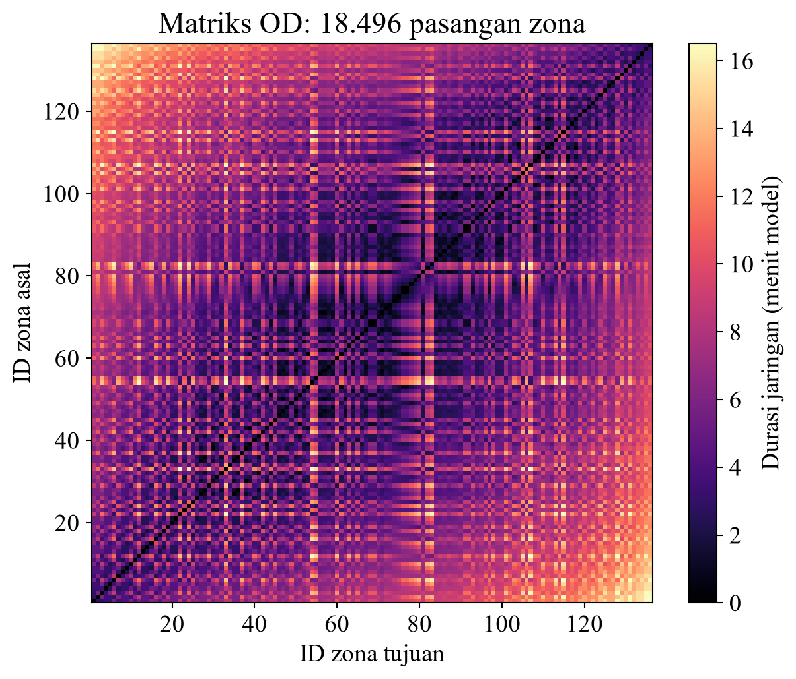

## 2.4 Persamaan dan Parameter

| Simbol | Arti | Nilai / satuan |
|---|---|---|
| B | Pekerjaan dasar yang ditetapkan sebagai input | Satuan pekerjaan model |
| P | Penduduk hasil alokasi | Satuan penduduk model |
| S | Pekerjaan jasa hasil alokasi | Satuan pekerjaan model |
| E | Seluruh pekerjaan, B + S | Satuan pekerjaan model |
| h | Penduduk per seluruh pekerja | 2 |
| e | Pekerjaan jasa per penduduk | 0,3 |
| a, b | Pangkat friction penduduk dan jasa | Baseline 1 dan 1 |
| c_ij | Biaya perjalanan yang sudah dikoreksi | Menit model |

G merupakan matriks alokasi penduduk dari pekerjaan. T merupakan matriks alokasi pekerjaan jasa dari penduduk. Kolom menyatakan zona yang menghasilkan besaran, sedangkan baris menyatakan zona yang menerima alokasi. Semua vektor dan sumbu matriks mengikuti zone_id 1–136.

**G_ij = h × c_ij^(−a) / Σ_k c_kj^(−a).**

**T_ij = e × c_ij^(−b) / Σ_k c_kj^(−b).**

Setiap kolom G berjumlah h dan setiap kolom T berjumlah e. Normalisasi berarti seluruh permintaan dari satu zona dibagi ke zona-zona penerima. Biaya yang lebih besar mendapat bobot lebih kecil, terutama ketika pangkat friction dinaikkan. Hubungan S_total=0,3P_total berlaku untuk seluruh kota; pekerjaan jasa di setiap zona tidak harus persis 30% penduduk zona yang sama karena pelayanan dialokasikan lintas zona. Tidak ada bobot daya tarik atau kapasitas lahan tambahan yang tidak tersedia pada data.

Hubungan umpan balik dinyatakan sebagai E=B+S, P=GE, dan S=TP. Substitusi memberi P=G(B+TP), sehingga sistem yang diselesaikan adalah **(I−GT)P=GB**. Implementasi menggunakan solver linear yang stabil; invers matriks eksplisit tidak diperlukan. Pekerjaan jasa kemudian dihitung dengan S=TP.

## 2.5 Keseimbangan, Konvergensi, dan Validasi

Solver asli KNIME berbasis faktorisasi LU dipertahankan. Solver independen menggunakan scipy.linalg.solve dan diperiksa dengan iterasi P_baru=G(B+TP_lama). Toleransi maksimum perubahan adalah 10 pangkat −11, dengan batas 1.000 iterasi. Baseline mencapai ambang tersebut dalam 53 iterasi. Radius spektral umpan balik sekitar 0,6, sesuai h×e=0,6 yang lebih kecil daripada satu.

Total kota harus memenuhi P_total=hB_total/(1−he) dan S_total=eP_total. Pemeriksaan lain mencakup geometri, ID, urutan zona, nilai nonnegatif, ukuran matriks, keterhubungan graf, residual persamaan, kesesuaian solver, dan kelengkapan join GIS. Tes menggunakan data asli serta kasus sintetik yang solusinya diketahui; keduanya tidak disamakan sebagai bukti yang identik.

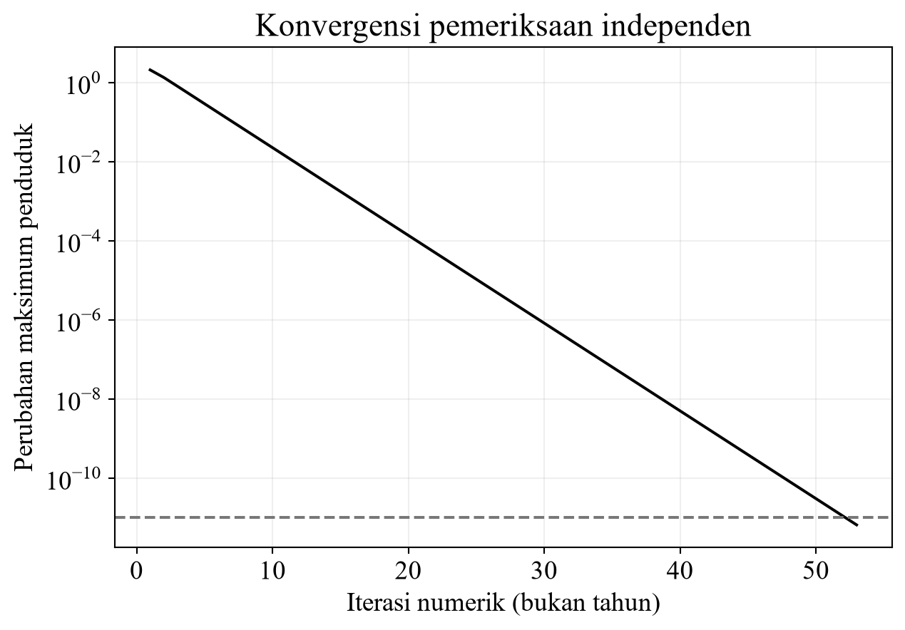

Transpose pada skrip asli tetap benar untuk baseline dan eksperimen dalam laporan karena kedua friction sama sehingga G dan T proporsional. Untuk friction penduduk dan jasa yang berbeda, core pendukung menggunakan urutan eksplisit G×T. Uji tiga zona dengan pangkat berbeda memastikan urutan matriks tidak keliru.

## 2.6 Desain Delapan Skenario

Seluruh skenario mempertahankan total pekerjaan dasar yang tersimpan dalam arsip. Baseline arsip memakai BEMP_Unif, sedangkan contoh pengantar manual memakai BEMP_CBD. Untuk eksperimen tiga pusat, pembanding utamanya adalah S7 terhadap S1; acuan umum tabel delapan skenario adalah S0.

| Kode | Pekerjaan dasar | Friction a=b | Jaringan |
|---|---|---:|---|
| S0 | BEMP_Unif asli | 1 | Semua ruas 30 mph |
| S1 | Seluruhnya di CBD | 1 | Baseline |
| S2 | Uniform | 0,5 | Baseline |
| S3 | Uniform | 2 | Baseline |
| S4 | Uniform | 1 | Ring 7 menjadi 75 mph |
| S5 | Seluruhnya di CBD | 2 | Baseline |
| S6 | Seluruhnya di CBD | 1 | Ring 7 menjadi 75 mph |
| S7 | CBD 40%, dua satelit 30%–30% | 1 | Baseline; studi mandiri |

# 3. Hasil dan Pembahasan

## 3.1 Bukti Proyek Berjalan

Workflow sebelumnya berhasil dijalankan pada 32/32 node. Setelah penambahan studi mandiri, workflow laporan berhasil dijalankan pada **34/34 node**. Arsip dibuat melalui ekspor native KNIME; detail status ekspor dan impor ulang dicatat dalam manifest validasi. Pengujian otomatis terakhir mencakup **29 tes lulus** dan tidak ada kegagalan. Batch Executor belum terpasang, tetapi eksekusi dan pengamatan output dilakukan melalui GUI.

Hasil native baseline dibandingkan dengan solver independen. Selisih maksimum penduduk sekitar 3,55 × 10 pangkat −15 dan pekerjaan jasa sekitar 1,11 × 10 pangkat −15. Matriks durasi jaringan yang dibangun ulang dibandingkan dengan cache OD asli berbeda paling banyak sekitar 8,31 × 10 pangkat −8 menit. Ini menunjukkan reproduksi komputasi dalam konfigurasi yang diuji, bukan validasi terhadap penduduk kota nyata.

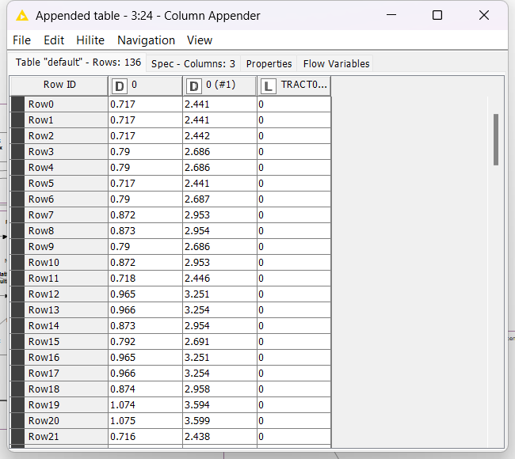

## 3.2 Baseline Penduduk dan Pekerjaan Jasa

| Indikator baseline uniform | Hasil |
|---|---:|
| Total pekerjaan dasar | 99,999984 |
| Total penduduk | 499,999920 |
| Total pekerjaan jasa | 149,999976 |
| Total seluruh pekerjaan | 249,999960 |
| Penduduk CBD, zona 71 | 5,429510 |
| Radius rata-rata berbobot | 2.764,184 meter proyeksi |
| Iterasi pemeriksaan independen | 53 |

Angka pekerjaan dasar asli berjumlah 99,999984, bukan tepat 100, karena presisi atribut BEMP_Unif. Oleh sebab itu, hasil aktual sedikit di bawah 500 dan 150. Nilai pecahan tidak dibulatkan sebelum perhitungan. Semua angka diinterpretasikan sebagai satuan model; laporan tidak mengklaim keberadaan setengah orang dalam data kependudukan nyata.

Pekerjaan dasar yang merata tidak menghasilkan penduduk yang seragam. Posisi zona dalam jaringan dan komponen biaya lokal berbeda. Zona CBD 71 memiliki penduduk tertinggi pada baseline. Pekerjaan jasa baseline juga paling tinggi di CBD, sebesar 1,668596 satuan model.

Pada tabel native Column Appender #24, kolom bernama 0 adalah pekerjaan jasa dan 0 (#1) adalah penduduk. TRACT0_ID merupakan penanda transek. Nama kolom lama dipertahankan agar workflow asli tetap dikenali; tabel CSV menggunakan nama population dan service_employment yang lebih jelas. Pembulatan tampilan GUI tidak mengubah presisi nilai yang dihitung.

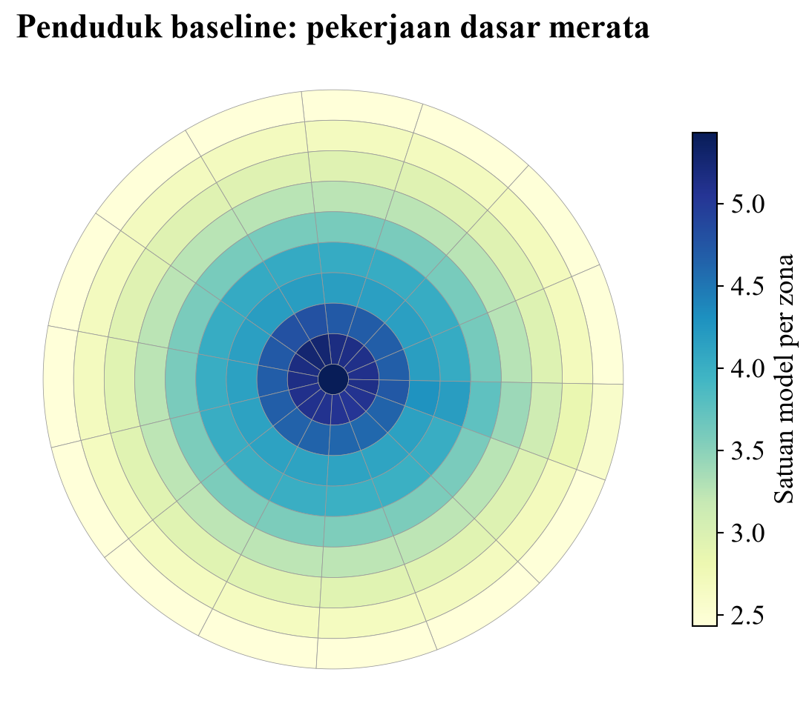

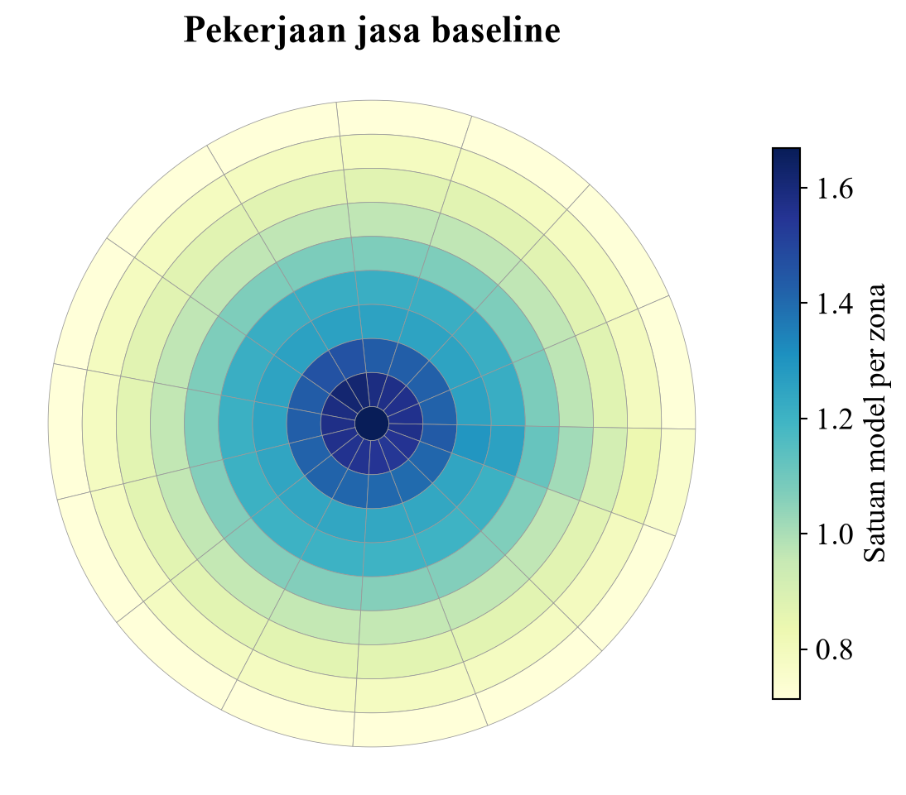

## 3.3 Perbandingan Skenario yang Sudah Dijalankan

| Skenario | P CBD | Radius berbobot (km) | HHI penduduk |
|---|---:|---:|---:|
| S0: uniform (arsip) | 5,430 | 2,764 | 0,007766 |
| S1: CBD tunggal | 9,151 | 2,543 | 0,008545 |
| S2: friction 0,5 | 4,452 | 2,960 | 0,007452 |
| S3: friction 2 | 7,987 | 2,383 | 0,009072 |
| S4: beltway | 5,179 | 2,841 | 0,007627 |
| S5: CBD + friction 2 | 21,865 | 1,895 | 0,013896 |
| S6: CBD + beltway | 8,969 | 2,593 | 0,008388 |
| S7: tiga pusat (mandiri) | 6,672 | 2,712 | 0,007919 |

P CBD adalah penduduk zona 71. Radius berbobot dihitung dengan bobot penduduk terhadap jarak proyeksi centroid ke CBD. HHI adalah jumlah kuadrat proporsi penduduk zona; semakin kecil nilainya, distribusi relatif semakin merata. HHI dipakai sebagai indikator perbandingan di dalam kota dan jumlah zona yang sama, bukan ukuran kesejahteraan masyarakat.

Friction 0,5 menghasilkan radius penduduk sekitar 2,960 km proyeksi, sedangkan friction 2 menghasilkan sekitar 2,383 km. Pada kondisi lainnya sama, penalti perjalanan yang lebih kuat membuat penduduk lebih dekat ke lokasi yang relatif mudah diakses. Kombinasi pekerjaan CBD dan friction 2 memberikan penduduk CBD tertinggi di antara seluruh eksperimen ini.

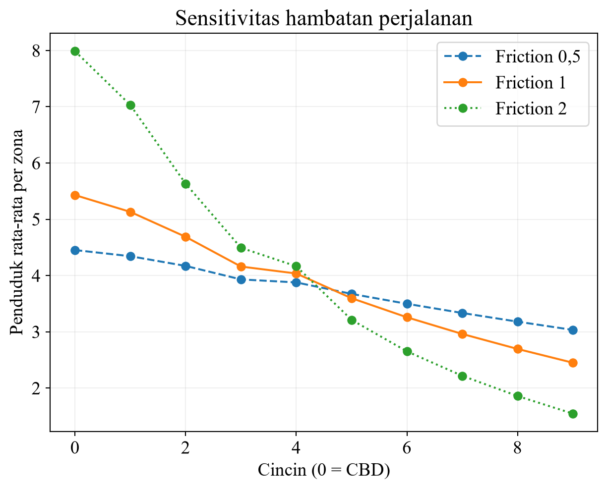

Peningkatan kecepatan ring 7 menurunkan durasi jaringan rata-rata dari 6,611 menjadi 5,737 menit model. Jarak jaringan geometris tidak berubah karena tidak ada ruas baru. Radius penduduk bertambah sekitar 77,08 meter terhadap uniform baseline. Dengan total pekerjaan tetap, yang berubah adalah alokasi ruang, bukan jumlah total penduduk kota.

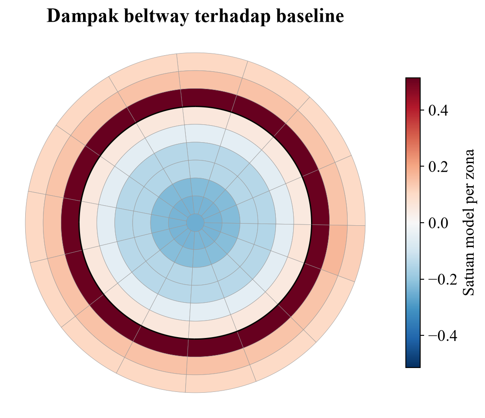

## 3.4 Cara Membaca Keluaran Delapan Skenario

Tabel output node #29 memuat 8 × 136 = 1.088 baris. Setiap baris adalah satu pasangan skenario dan zona, bukan satu zona unik untuk keseluruhan tabel. zone_id boleh berulang antar skenario, tetapi setiap kombinasi scenario–zone_id harus unik. Native Joiner #30 menghasilkan jumlah baris yang sama dengan kolom geometri.

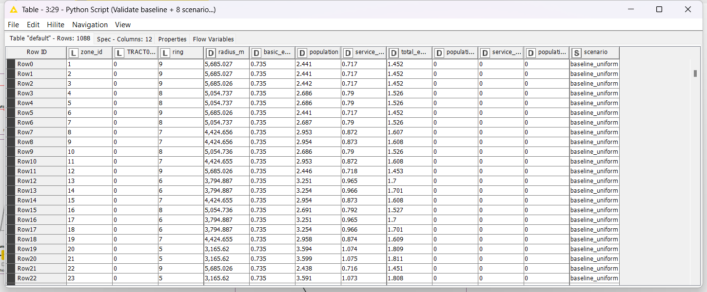

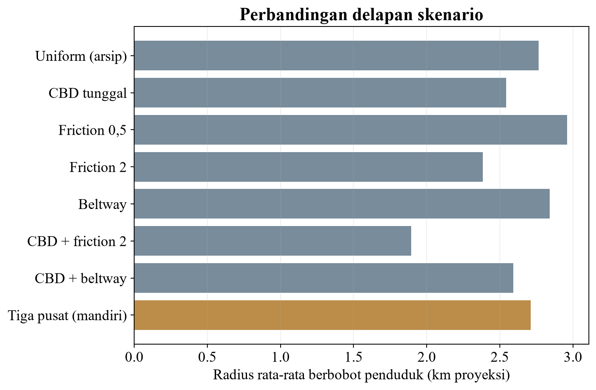

Saat membandingkan peta, periksa variabel dan legenda. Peta jumlah, kepadatan, dan perubahan adalah tiga hal berbeda. Peta perubahan tiga pusat memakai CBD tunggal sebagai acuan, sedangkan peta beltway memakai uniform. Nilai merah atau biru tidak dapat dibandingkan lintas peta tanpa membaca acuan dan skalanya.

## 3.5 Studi Kasus Mandiri: Kota Tiga Pusat

**Pertanyaan eksperimen.** Jika kota mengembangkan dua pusat pekerjaan baru di luar CBD, apakah penduduk dan pekerjaan jasa menjadi lebih tersebar? Rancangan ini membandingkan CBD tunggal dengan tiga pusat pekerjaan pada geometri kota yang sama. Ini merupakan studi kasus tambahan yang dibuat khusus untuk proyek, bukan pengulangan skenario beltway atau perubahan friction.

**Desain yang ditetapkan.** CBD mendapat 40% total pekerjaan dasar. Dua satelit mendapat masing-masing 30%. Sasaran lokasi diletakkan pada offset −3.800 dan +3.800 meter proyeksi dari CBD pada sumbu timur–barat, lalu dipilih centroid asli yang terdekat. Zona yang terpilih adalah CBD 71, Satelit Barat 63, dan Satelit Timur 79. Jarak aktual satelit terhadap CBD sekitar 3,795 dan 3,805 km proyeksi. Kedua lokasi hanya mendekati arah barat dan timur; geometri 15 sektor tidak menjamin posisi berlawanan yang benar-benar simetris.

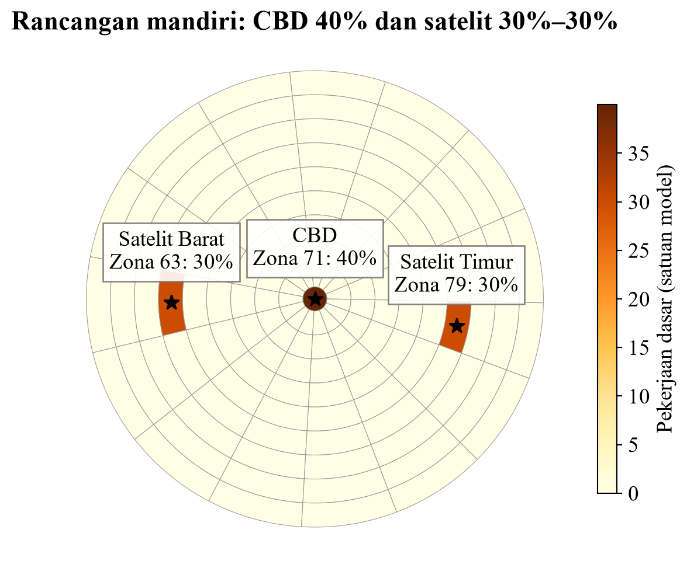

**Variabel yang dikendalikan.** Total pekerjaan dasar tetap 99,999984, h=2, e=0,3, kedua friction=1, dan seluruh kecepatan jalan tetap 30 mph. Matriks OD baseline dipakai tanpa perubahan karena jaringan tidak dimodifikasi. Dengan demikian, perbedaan hasil disebabkan perubahan lokasi pekerjaan dasar di dalam struktur model, bukan penambahan pekerjaan atau pembangunan jalan.

**Hasil pada tiga pusat.** Angka berikut adalah satuan simulasi. P berarti penduduk. Kolom sebelum merujuk skenario CBD tunggal, bukan baseline uniform.

| Lokasi | Pekerjaan dasar baru | P sebelum | P sesudah | Perubahan P |
|---|---:|---:|---:|---:|
| CBD (zona 71) | 40,000 | 9,151 | 6,672 | -2,479 |
| Satelit Barat (zona 63) | 30,000 | 2,905 | 3,925 | 1,020 |
| Satelit Timur (zona 79) | 30,000 | 2,983 | 4,182 | 1,199 |

Penduduk CBD berubah dari 9,151 menjadi 6,672, turun 27,09%. Penduduk zona 63 dan 79 meningkat. Radius rata-rata berbobot penduduk berubah dari 2,543 menjadi 2,712 km proyeksi, atau bergerak ke luar 168,64 meter. HHI menurun dari 0,008545 menjadi 0,007919, setara penurunan 7,33%.

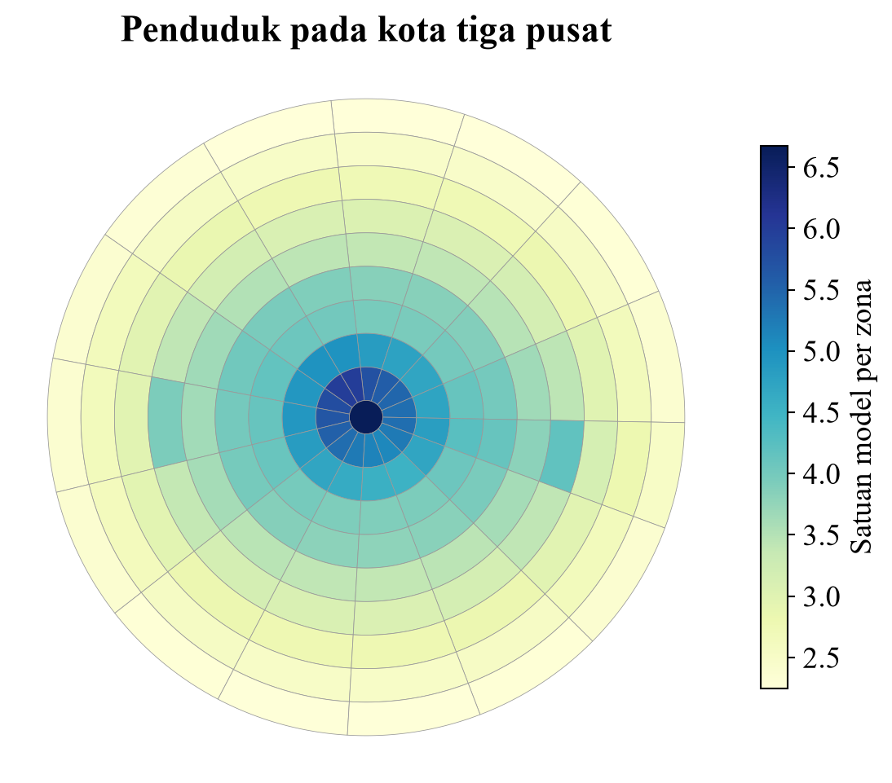

**Cara membaca peta perubahan.** Nilai positif menunjukkan tambahan penduduk dibandingkan CBD tunggal; nilai negatif menunjukkan pengurangan. Peta memakai skala warna simetris terhadap nol. Total perubahan mendekati nol karena total penduduk tetap. Besaran setengah jumlah perubahan absolut adalah 25,955 satuan penduduk; ini mengukur besarnya realokasi antarzona pada dua solusi keseimbangan, bukan arus migrasi yang diobservasi.

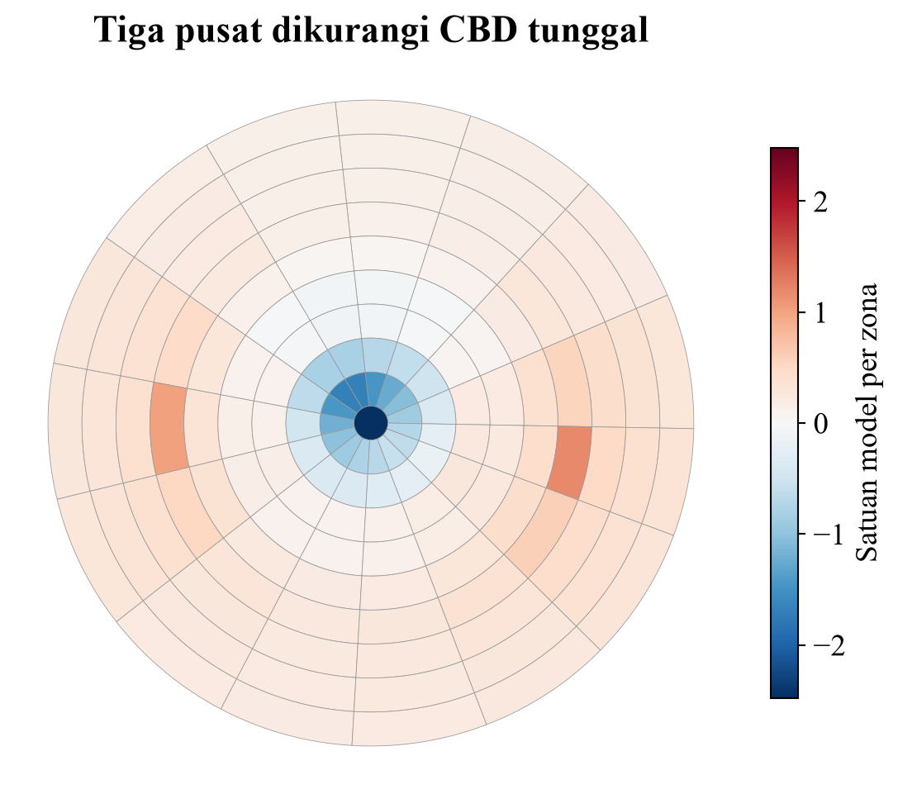

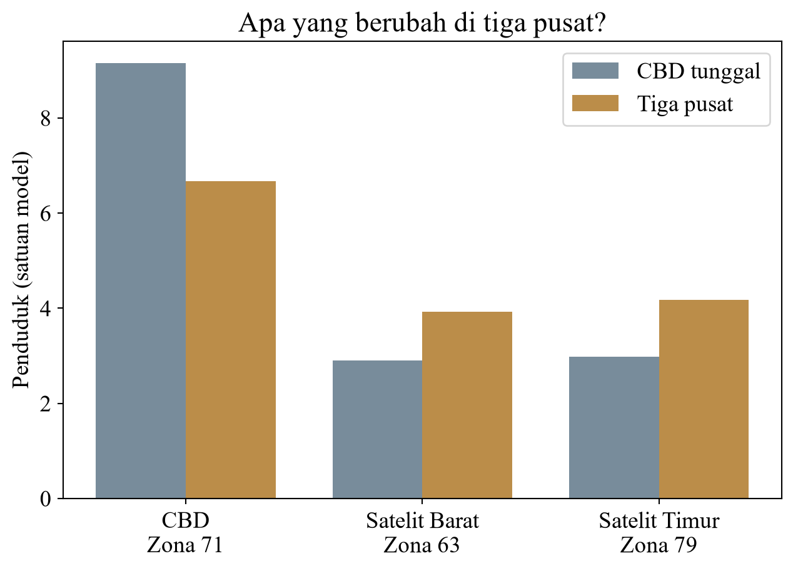

**Interpretasi yang didukung.** Desentralisasi input pekerjaan mengurangi konsentrasi penduduk dibandingkan kota CBD tunggal. Namun, zona dengan penduduk dan pekerjaan jasa tertinggi tetap CBD 71. Tiga pusat pekerjaan tidak otomatis menghasilkan tiga puncak penduduk dengan besar yang sama; posisi pusat dalam jaringan dan umpan balik pelayanan tetap berpengaruh. HHI skenario ini juga masih lebih tinggi daripada baseline uniform. Kesimpulan yang tepat adalah lebih tersebar dibandingkan CBD tunggal, bukan paling merata di antara semua skenario.

**Bukti di KNIME.** Node #29 mengeluarkan delapan skenario, masing-masing 136 zona, sehingga tabel lengkap berisi 1.088 baris. Node #30 menggabungkannya dengan geometri. Row Filter #33 memilih polycentric_centers dan Geospatial View #34 menampilkan 136 poligon studi mandiri. Node asli 1–26 tetap dipertahankan.

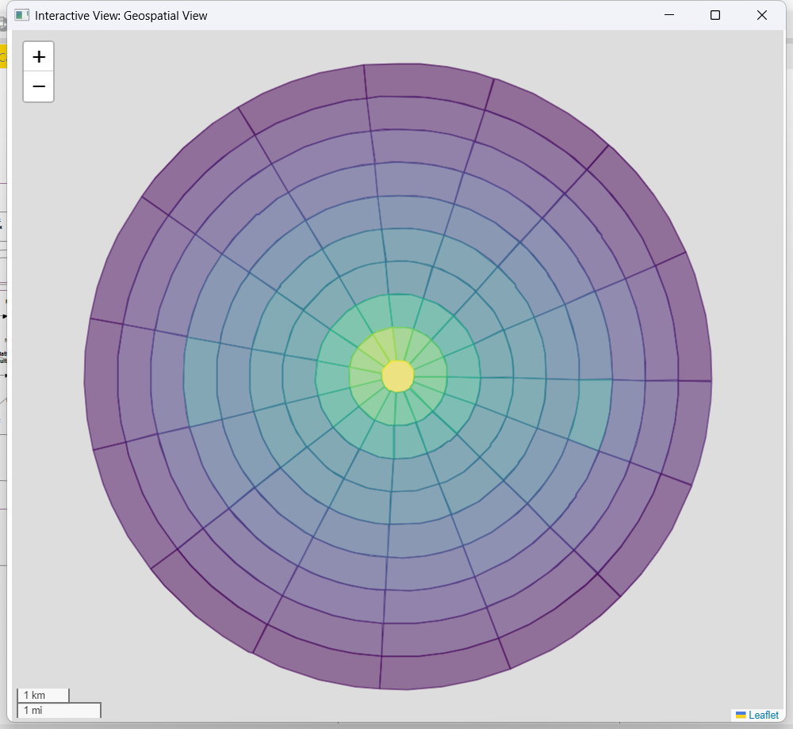

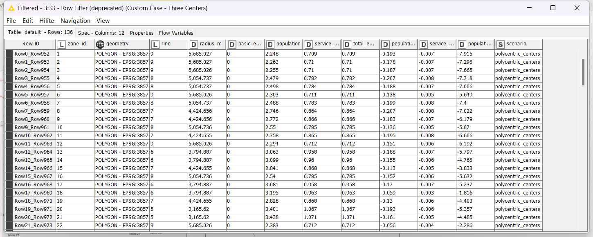

## 3.6 Keterbatasan dan Makna Hasil

Model belum memasukkan kapasitas perumahan, harga lahan, preferensi rumah tangga, atau kemacetan yang timbul akibat peningkatan arus. Semua perubahan input adalah eksperimen teoritis. Lokasi EPSG:3857 pada berkas tidak menjadikan kota hipotetis ini sebuah kota nyata. Pengujian dilakukan pada satu konfigurasi Windows dan KNIME; lingkungan lain perlu divalidasi kembali.

Peta menunjukkan solusi keseimbangan, bukan jalur perpindahan penduduk dari tahun ke tahun. Pertambahan pada zona satelit dalam dua hasil model tidak membuktikan adanya migrasi nyata. Karena total pekerjaan dasar dan rasio demografis tetap, jumlah penduduk dan pekerjaan jasa seluruh kota hampir sama pada delapan kasus. Hal ini merupakan identitas model yang diperiksa, bukan kegagalan skenario untuk menghasilkan perubahan spasial.

# 4. Kesimpulan dan Rekomendasi

## 4.1 Kesimpulan

Implementasi Case 10 berhasil direproduksi melalui workflow KNIME asli yang dipertahankan. Dataset 136 zona dan jaringan 330 fitur digunakan untuk menghitung seluruh 18.496 pasangan OD. Persamaan keseimbangan menghasilkan distribusi penduduk dan pekerjaan jasa yang sesuai dengan cache asli, solver independen, pemeriksaan iterasi, serta konservasi total.

Delapan skenario menunjukkan bahwa pekerjaan dasar, friction, dan kecepatan jaringan memengaruhi persebaran ruang. Pada studi mandiri, pembagian CBD 40% dan dua satelit masing-masing 30% mengurangi penduduk CBD 27,09% terhadap kota CBD tunggal, tetapi CBD tetap menjadi zona dengan jumlah penduduk dan pekerjaan jasa tertinggi. Kesimpulan terbatas pada geometri dan asumsi yang diuji.

## 4.2 Rekomendasi Pengembangan

- Gunakan hasil sebagai bahan pembelajaran hubungan pekerjaan–penduduk–pelayanan dan sebagai pembanding eksperimen, bukan penetapan langsung kebijakan kota nyata.
- Jika diterapkan pada kota nyata, kalibrasikan biaya perjalanan dan parameter dengan data aktual, lalu tambahkan kapasitas lahan serta mekanisme kemacetan yang sesuai.
- Untuk menilai alternatif pusat satelit, uji lebih dari satu lokasi dan pembagian pekerjaan serta pertahankan acuan perbandingan yang konsisten.
- Saat mereproduksi, gunakan launcher proyek, interpreter yang didokumentasikan, reset workflow setelah pemindahan lokasi, dan periksa log serta jumlah baris output.

# Daftar Pustaka

[1] Lowry, I. S. (1964). A Model of Metropolis. RAND Corporation, Research Memorandum RM-4035-RC. https://www.rand.org/pubs/research_memoranda/RM4035.html

[2] Garin, R. A. (1966). Research Note: A Matrix Formulation of the Lowry Model for Intrametropolitan Activity Allocation. Journal of the American Institute of Planners, 32(6), 361–364. https://doi.org/10.1080/01944366608978511

[3] Liu, L., dan Wang, F. (2023). Computational Methods and GIS Applications in Social Science — Lab Manual. CRC Press. Case 10, halaman cetak 196–203; halaman PDF 215–222 pada berkas yang disuplai. DOI bab: 10.1201/9781003304357-10.

[4] KNIME. (tanpa tahun). Python Scripting API: knime.scripting.io. Dokumentasi resmi. Diakses 10 November 2026. https://docs.knime.com/ap/latest/python-script-api/

[5] KNIME. (tanpa tahun). Create a Node with Python: Customizing the Python Executable and Registering Python Extensions. Dokumentasi resmi. Diakses 10 November 2026. https://docs.knime.com/developers/latest/create_a_node_with_python/

Sumber data dan hasil: arsip workflow Case 10 serta dataset yang disuplai dalam workspace ProjectSIG; tabel, GeoPackage, log, dan tangkapan layar yang dihasilkan oleh proyek ini. Rancangan pembagian pekerjaan 40%–30%–30% merupakan asumsi eksperimen mandiri dalam proyek ini, bukan temuan atau parameter yang diklaim berasal dari referensi [1]–[3].

# Lampiran: Berkas Hasil dan Cara Reproduksi

| Berkas / lokasi | Kegunaan |
|---|---|
| knime/Case10_Garin_Lowry_Final.knwf | Arsip tujuh skenario sebelumnya, tetap dipertahankan |
| knime/Case10_Garin_Lowry_Extended_8_Scenarios.knwf | Workflow pengembangan delapan skenario |
| outputs/tables/scenario_comparison_extended.csv | Ringkasan numerik delapan skenario |
| outputs/tables/all_scenarios_extended.csv | Seluruh 1.088 baris hasil |
| outputs/tables/polycentric_centers.csv | 136 hasil zona studi mandiri |
| outputs/tables/custom_centers.csv | Lokasi dan pembagian pekerjaan tiga pusat |
| outputs/tables/custom_change_vs_cbd.csv | Perubahan studi mandiri terhadap CBD tunggal |
| outputs/maps/polycentric_centers.gpkg | Hasil geometri studi mandiri untuk GIS |
| outputs/reports/screenshots/ | Bukti tangkapan layar KNIME dalam laporan |
| outputs/logs/extended_validation.json | Status native, arsip, dan pengujian tambahan |
| docs/KNIME_SETUP.md | Langkah konfigurasi dan validasi GUI |

Perintah reproduksi dari direktori proyek adalah python -m src.main all, kemudian python -m src.custom_case. Gunakan executable .venv/Scripts/python.exe agar lingkungan sesuai. Jalankan pytest untuk tes. Untuk KNIME, gunakan launcher proyek dan buka workflow extended, lalu Reset all dan Execute all. Keluaran yang dihasilkan dalam KNIME disimpan pada data/case10_project/outputs/ di dalam direktori workflow tersebut, sedangkan keluaran yang dipakai laporan proyek berada pada outputs/ di direktori proyek utama.
