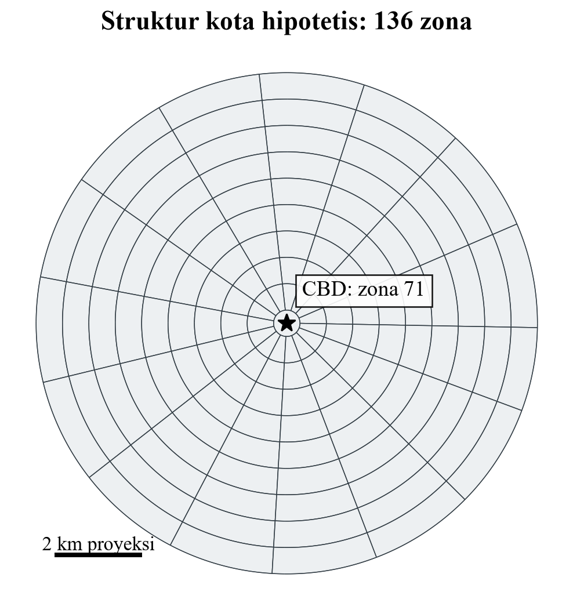
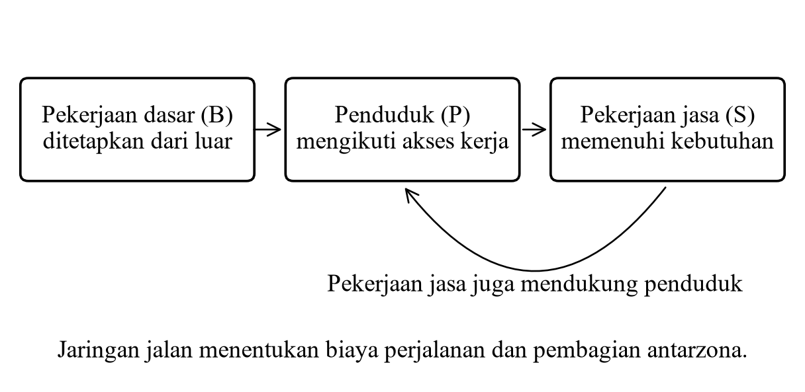
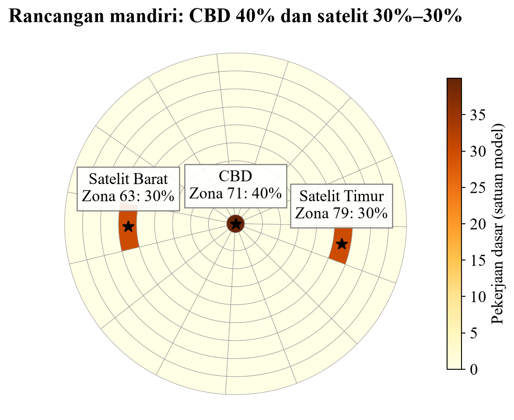

# 1. Apa yang Dikerjakan Proyek Ini?

Proyek ini menjawab pertanyaan sederhana: jika lokasi pekerjaan dan kemudahan bepergian berubah, di bagian kota mana penduduk serta pekerjaan jasa akan terkonsentrasi? Kita memakai kota buatan dengan 136 zona. Kota tersebut berguna untuk eksperimen yang bisa dikendalikan, sehingga hasil bukan ramalan sebuah kota nyata.

# 2. Cara Kerjanya dengan Analogi

Bayangkan sebuah pusat pekerjaan baru. Pekerjaan mendukung penduduk. Penduduk membutuhkan toko dan jasa. Layanan baru menciptakan pekerjaan jasa, lalu pekerjaan jasa juga mendukung penduduk. Model mencari angka yang membuat hubungan itu konsisten di seluruh zona.

Contoh totalnya: 100 pekerjaan dasar, rasio dua penduduk per pekerjaan total, dan 0,3 pekerjaan jasa per penduduk memberi keseimbangan 500 penduduk dan 150 pekerjaan jasa. Di file asli, jumlah pekerjaan dasar sedikit di bawah 100 karena pembulatan atribut; itulah sebabnya hasil aktual sedikit di bawah 500 dan 150.

Jalan berfungsi menentukan biaya berpindah antarzona. Model memakai rute jaringan, bukan garis lurus. Friction berarti seberapa kuat perjalanan yang mahal dihukum: makin besar angkanya, makin kecil kecenderungan alokasi ke lokasi yang sulit dijangkau. Iterasi berarti langkah perhitungan untuk mengecek keseimbangan, bukan tahun.

# 3. Mengapa Memakai KNIME?

KNIME membuat urutan kerja terlihat: membaca geografi, menghitung OD, membentuk matriks, menjalankan solver, menggabungkan hasil dengan peta, dan mengekspor keluaran. Python dipakai untuk perhitungan matriks dan skenario; workflow asli tetap menjadi dasar proyek.

Versi laporan memiliki 34 node dan delapan skenario. Tabel hasil skenario memuat 1.088 baris karena ada 136 zona untuk setiap skenario. Peta satu skenario hanya berisi 136 zona. TRACT0_ID bukan ID unik; kunci join hasil adalah zone_id.

# 4. Apa Saja Studi Kasusnya?

- Pekerjaan dasar uniform: input pekerjaan merata ke seluruh zona.
- CBD tunggal: pekerjaan dasar dipusatkan di pusat kota.
- Friction rendah dan tinggi: menguji kekuatan hambatan perjalanan.
- Beltway: menaikkan kecepatan ring 7 dari 30 menjadi 75 mph.
- Dua kombinasi CBD: CBD dengan friction tinggi dan CBD dengan beltway.
- Studi mandiri baru: CBD mendapat 40% pekerjaan dasar, dua satelit mendapat 30% masing-masing.

Pembanding utama studi mandiri adalah CBD tunggal. Hasilnya, penduduk CBD turun 27,09%, tetapi CBD masih menjadi zona dengan penduduk tertinggi. Artinya, pekerjaan menjadi bertiga pusat, sementara penduduk tidak otomatis memiliki tiga puncak yang sama kuat.

# 5. Cara Menjelaskan Hasil kepada Dosen

Sampaikan bahwa hasil utama bukan perubahan total penduduk, melainkan perubahan letaknya. Semua skenario mempertahankan total pekerjaan dasar dan rasio demografis. Jumlah total yang sama memang diharapkan secara matematis, sementara nilai setiap zona dapat berubah.

Pada peta jumlah, warna menunjukkan nilai per zona. Pada peta perubahan, nilai positif berarti naik terhadap skenario pembanding dan nilai negatif berarti turun. Periksa legenda dan pembandingnya. Penduduk per zona tidak sama dengan kepadatan penduduk. Jangan menyebut hasil sebagai bukti migrasi nyata atau rekomendasi kebijakan yang sudah siap diterapkan.

# 6. Apakah Sudah Berjalan dan Bagaimana Membukanya?

Versi sebelumnya sudah dijalankan di KNIME pada 32 node. Versi extended juga berhasil pada 34/34 node dan sudah diimpor ulang untuk pemeriksaan. Pengujian terakhir proyek berisi 29 tes lulus. Laporan utama memuat screenshot workflow, tabel, dan peta output KNIME.

Mulai KNIME melalui launcher proyek agar perbaikan kompatibilitas lokal aktif. Pilih workflow extended atau impor arsip delapan skenario, lakukan Reset all lalu Execute all. Node #24 menunjukkan hasil baseline, #29 hasil delapan skenario, dan #34 peta tiga pusat. Panduan lengkap berada pada docs/KNIME_SETUP.md dan petunjuk laporan tambahan.

Kalimat penutup presentasi yang bisa dipakai: “Pada kota hipotetis ini, lokasi pekerjaan dan biaya perjalanan mengubah persebaran penduduk serta jasa. Pembentukan pusat satelit mengurangi konsentrasi terhadap CBD tunggal, tetapi hasil tetap dibatasi oleh asumsi model dan belum menjadi prediksi kota nyata.”
