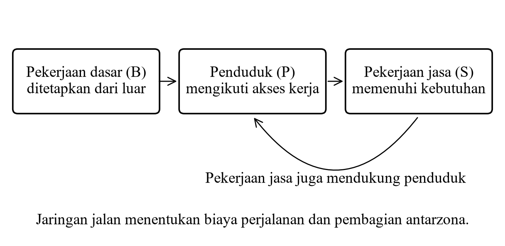
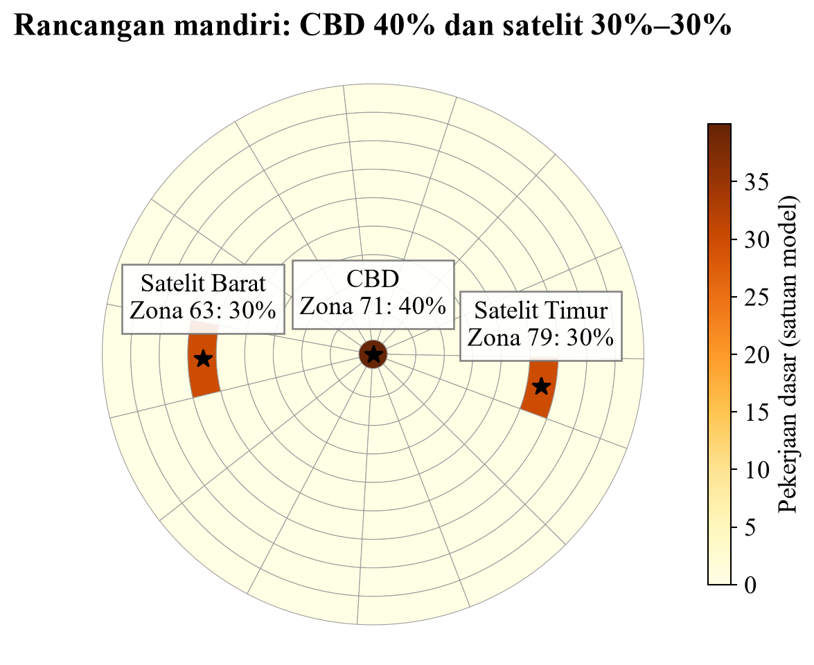
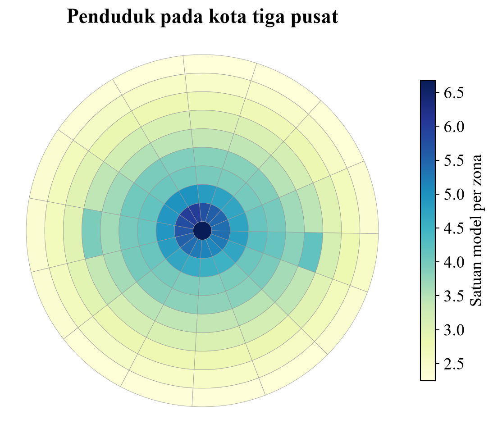
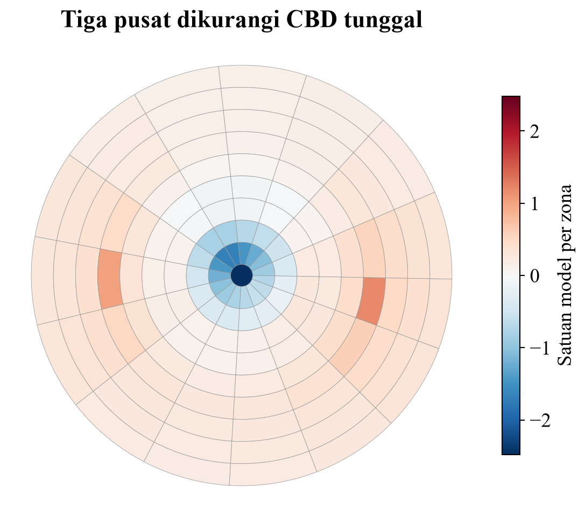
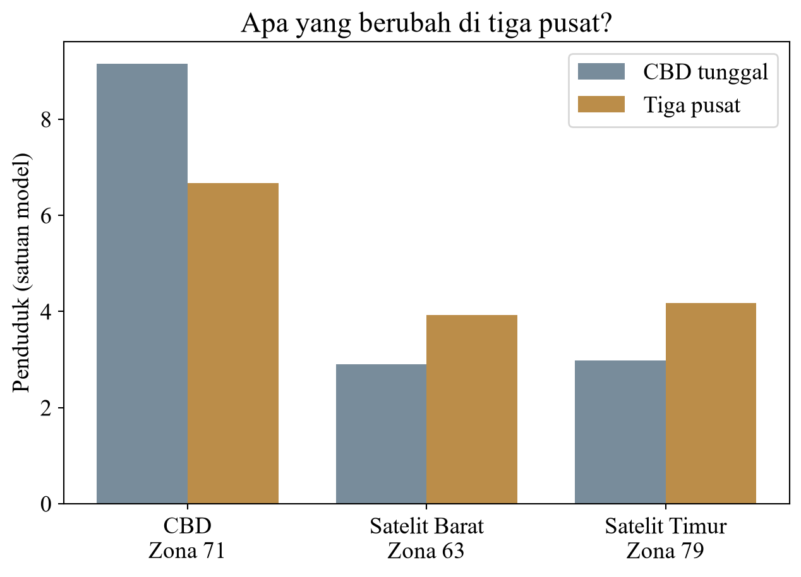
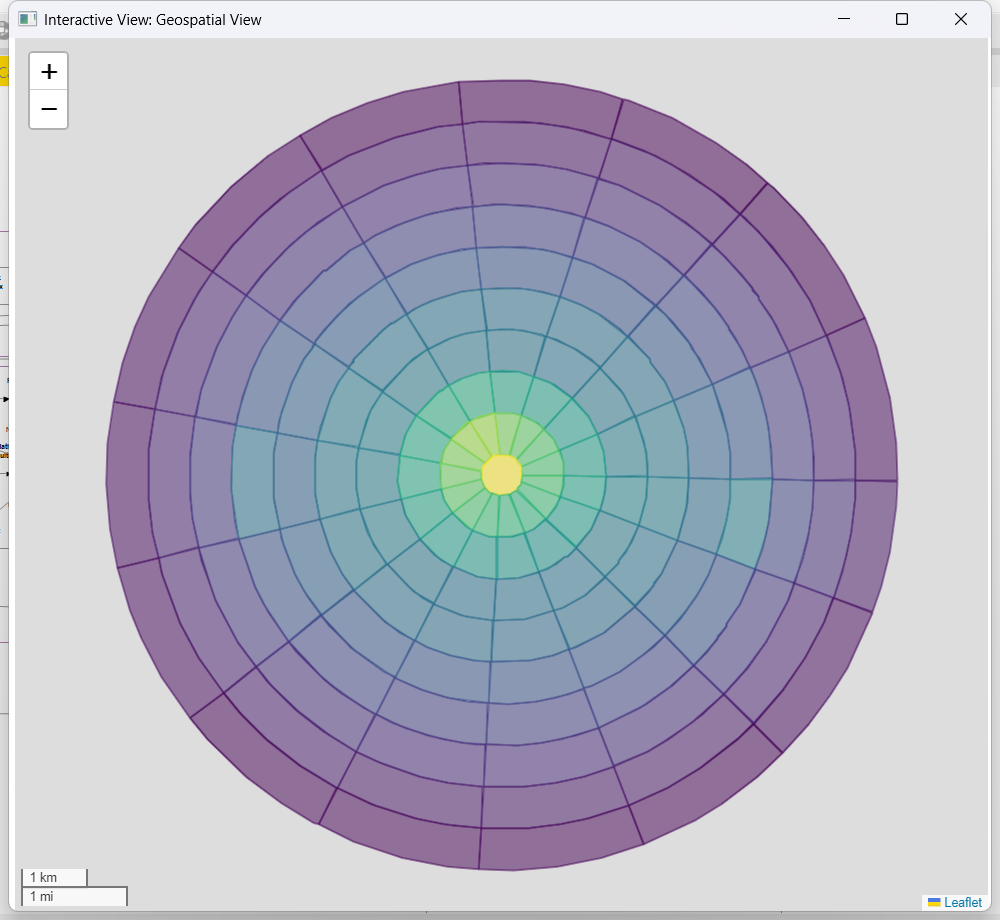
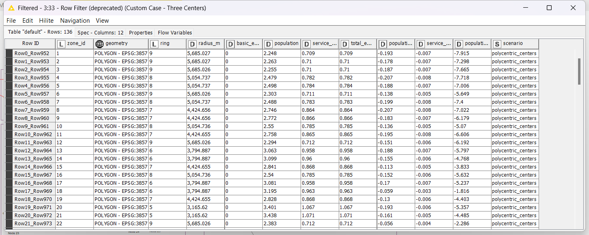

# 1. Pendahuluan

## 1.1 Masalah dan Asal Rancangan

Studi ini merancang satu eksperimen yang belum ada pada tujuh skenario proyek sebelumnya: pembentukan dua pusat satelit dengan CBD tetap dipertahankan. Pertanyaannya adalah apakah pengalihan sebagian pekerjaan dasar dari pusat ke luar dapat mengubah pembagian penduduk dan pekerjaan jasa. Data geografi menggunakan kota hipotetis Case 10 asli; distribusi pekerjaan 40%–30%–30% merupakan asumsi baru yang dinyatakan terbuka.

## 1.2 Tujuan

Tujuannya membandingkan kota dengan semua pekerjaan dasar di CBD terhadap kota dengan tiga pusat pekerjaan. Total pekerjaan, jaringan, dan parameter dibuat sama agar pengaruh lokasi input dapat diperiksa secara terpisah.

# 2. Metodologi

Data terdiri atas 136 poligon, 136 centroid, dan 330 fitur jalan dalam EPSG:3857. Matriks biaya menggunakan hasil jaringan baseline. Persamaan yang diselesaikan adalah (I−GT)P=GB dan S=TP. h=2, e=0,3, dan kedua friction=1. Solver langsung dibandingkan dengan iterasi independen. Seluruh studi merupakan simulasi teoritis, bukan prediksi penduduk kota nyata.

KNIME mempertahankan 26 node asli. Pengembangan mencakup seluruh delapan skenario pada node #29 dan peta khusus melalui filter #33 serta view #34. Workflow extended mempunyai 34 node. Hasil beserta bukti eksekusi dan arsip tersimpan bersama proyek.

# 3. Hasil dan Pembahasan

**Pertanyaan eksperimen.** Jika kota mengembangkan dua pusat pekerjaan baru di luar CBD, apakah penduduk dan pekerjaan jasa menjadi lebih tersebar? Rancangan ini membandingkan CBD tunggal dengan tiga pusat pekerjaan pada geometri kota yang sama. Ini merupakan studi kasus tambahan yang dibuat khusus untuk proyek, bukan pengulangan skenario beltway atau perubahan friction.

**Desain yang ditetapkan.** CBD mendapat 40% total pekerjaan dasar. Dua satelit mendapat masing-masing 30%. Sasaran lokasi diletakkan pada offset −3.800 dan +3.800 meter proyeksi dari CBD pada sumbu timur–barat, lalu dipilih centroid asli yang terdekat. Zona yang terpilih adalah CBD 71, Satelit Barat 63, dan Satelit Timur 79. Jarak aktual satelit terhadap CBD sekitar 3,795 dan 3,805 km proyeksi. Kedua lokasi hanya mendekati arah barat dan timur; geometri 15 sektor tidak menjamin posisi berlawanan yang benar-benar simetris.

**Variabel yang dikendalikan.** Total pekerjaan dasar tetap 99,999984, h=2, e=0,3, kedua friction=1, dan seluruh kecepatan jalan tetap 30 mph. Matriks OD baseline dipakai tanpa perubahan karena jaringan tidak dimodifikasi. Dengan demikian, perbedaan hasil disebabkan perubahan lokasi pekerjaan dasar di dalam struktur model, bukan penambahan pekerjaan atau pembangunan jalan.

**Hasil pada tiga pusat.** Angka berikut adalah satuan simulasi. P berarti penduduk. Kolom sebelum merujuk skenario CBD tunggal, bukan baseline uniform.

| Lokasi | Pekerjaan dasar baru | P sebelum | P sesudah | Perubahan P |
|---|---:|---:|---:|---:|
| CBD (zona 71) | 40,000 | 9,151 | 6,672 | -2,479 |
| Satelit Barat (zona 63) | 30,000 | 2,905 | 3,925 | 1,020 |
| Satelit Timur (zona 79) | 30,000 | 2,983 | 4,182 | 1,199 |

Penduduk CBD berubah dari 9,151 menjadi 6,672, turun 27,09%. Penduduk zona 63 dan 79 meningkat. Radius rata-rata berbobot penduduk berubah dari 2,543 menjadi 2,712 km proyeksi, atau bergerak ke luar 168,64 meter. HHI menurun dari 0,008545 menjadi 0,007919, setara penurunan 7,33%.

**Cara membaca peta perubahan.** Nilai positif menunjukkan tambahan penduduk dibandingkan CBD tunggal; nilai negatif menunjukkan pengurangan. Peta memakai skala warna simetris terhadap nol. Total perubahan mendekati nol karena total penduduk tetap. Besaran setengah jumlah perubahan absolut adalah 25,955 satuan penduduk; ini mengukur besarnya realokasi antarzona pada dua solusi keseimbangan, bukan arus migrasi yang diobservasi.

**Interpretasi yang didukung.** Desentralisasi input pekerjaan mengurangi konsentrasi penduduk dibandingkan kota CBD tunggal. Namun, zona dengan penduduk dan pekerjaan jasa tertinggi tetap CBD 71. Tiga pusat pekerjaan tidak otomatis menghasilkan tiga puncak penduduk dengan besar yang sama; posisi pusat dalam jaringan dan umpan balik pelayanan tetap berpengaruh. HHI skenario ini juga masih lebih tinggi daripada baseline uniform. Kesimpulan yang tepat adalah lebih tersebar dibandingkan CBD tunggal, bukan paling merata di antara semua skenario.

**Bukti di KNIME.** Node #29 mengeluarkan delapan skenario, masing-masing 136 zona, sehingga tabel lengkap berisi 1.088 baris. Node #30 menggabungkannya dengan geometri. Row Filter #33 memilih polycentric_centers dan Geospatial View #34 menampilkan 136 poligon studi mandiri. Node asli 1–26 tetap dipertahankan.

# 4. Kesimpulan dan Rekomendasi

Rancangan tiga pusat menurunkan penduduk CBD sekitar 27,09% dan memperbesar radius rata-rata berbobot penduduk sekitar 168,64 meter proyeksi dibandingkan CBD tunggal. Jumlah total penduduk dan pekerjaan jasa tetap karena pekerjaan dasar serta rasio demografis tidak berubah. CBD tetap menjadi zona dengan penduduk tertinggi; hasil tidak mendukung klaim bahwa tiga puncak permukiman terbentuk dengan besar yang sama.

Rancangan layak dipakai sebagai eksperimen pembelajaran. Untuk perencanaan nyata, dibutuhkan data perjalanan, kapasitas lahan, serta kalibrasi parameter. Studi berikutnya dapat menguji alternatif lokasi satelit dan pembagian 40%–30%–30% tanpa mengubah total pekerjaan sebagai kontrol.

Pengujian terakhir proyek: 29 tes lulus. Status native workflow extended dan impor arsip dicatat pada outputs/logs/extended_validation.json. Hasil rinci 136 zona tersedia pada outputs/tables/polycentric_centers.csv dan GeoPackage dengan nama yang sama.

# Daftar Pustaka

[1] Lowry, I. S. (1964). A Model of Metropolis. RAND Corporation, Research Memorandum RM-4035-RC. https://www.rand.org/pubs/research_memoranda/RM4035.html

[2] Garin, R. A. (1966). Research Note: A Matrix Formulation of the Lowry Model for Intrametropolitan Activity Allocation. Journal of the American Institute of Planners, 32(6), 361–364. https://doi.org/10.1080/01944366608978511

[3] Liu, L., dan Wang, F. (2023). Computational Methods and GIS Applications in Social Science — Lab Manual. CRC Press. Case 10, halaman cetak 196–203; halaman PDF 215–222 pada berkas yang disuplai. DOI bab: 10.1201/9781003304357-10.

[4] KNIME. (tanpa tahun). Python Scripting API: knime.scripting.io. Dokumentasi resmi. Diakses 10 November 2026. https://docs.knime.com/ap/latest/python-script-api/

[5] KNIME. (tanpa tahun). Create a Node with Python: Customizing the Python Executable and Registering Python Extensions. Dokumentasi resmi. Diakses 10 November 2026. https://docs.knime.com/developers/latest/create_a_node_with_python/

Sumber data dan hasil: arsip workflow Case 10 serta dataset yang disuplai dalam workspace ProjectSIG; tabel, GeoPackage, log, dan tangkapan layar yang dihasilkan oleh proyek ini. Rancangan pembagian pekerjaan 40%–30%–30% merupakan asumsi eksperimen mandiri dalam proyek ini, bukan temuan atau parameter yang diklaim berasal dari referensi [1]–[3].

